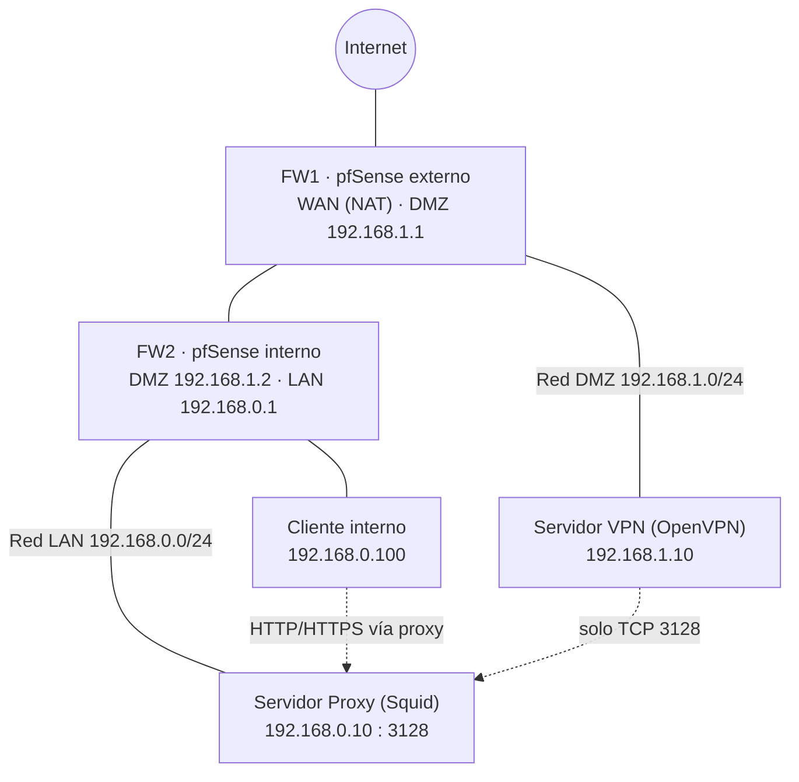

# 🛡️ DMZ con doble firewall, VPN y proxy

Laboratorio de seguridad perimetral en VirtualBox: una red con **zona desmilitarizada (DMZ)** protegida por **dos firewalls pfSense** en cascada, un **servidor VPN (OpenVPN)** expuesto en la DMZ y una red interna que sale a Internet únicamente a través de un **proxy Squid** con filtrado de sitios y horarios.

## 🎯 Objetivos

- Separar la red en **tres zonas** (Internet, DMZ y LAN) con dos firewalls, de forma que un compromiso de la DMZ no dé acceso a la red interna.
- Publicar un **servicio VPN** (OpenVPN, UDP 1194) desde la DMZ.
- Obligar a que los equipos internos naveguen **a través de un proxy** que bloquea sitios y aplica restricciones horarias.
- **Verificar** el aislamiento con pruebas de conectividad y de seguridad.

## 🧱 Tecnologías

| Componente | Tecnología |
|------------|-----------|
| Virtualización | VirtualBox (redes NAT e internas) |
| Firewalls | pfSense 2.6.0 (FW1 y FW2) |
| VPN | OpenVPN + Easy-RSA sobre Ubuntu Server 18.04 |
| Proxy | Squid 3.5 sobre Ubuntu Server 18.04 |
| Cliente | Windows 10 |

## 📖 Guía

| # | Documento | Contenido |
|---|-----------|-----------|
| 1 | [Arquitectura](./docs/01-arquitectura.md) | Zonas, direccionamiento y política de tráfico |
| 2 | [Máquinas en VirtualBox](./docs/02-maquinas-virtualbox.md) | Recursos y adaptadores de red de cada VM |
| 3 | [Firewalls pfSense](./docs/03-firewalls-pfsense.md) | Reglas y NAT de FW1 y FW2 |
| 4 | [Proxy Squid](./docs/04-proxy-squid.md) | Instalación, ACL, lista negra y horarios |
| 5 | [Servidor VPN](./docs/05-vpn-openvpn.md) | OpenVPN, PKI, reenvío y NAT |
| 6 | [Pruebas](./docs/06-pruebas.md) | Conectividad, bloqueos y aislamiento |
| 7 | [Problemas y mejoras](./docs/07-problemas-y-mejoras.md) | Errores detectados, correcciones y trabajo futuro |

## 🗂️ Contenido

- [`docs/`](./docs): documentación por apartados.
- [`configs/`](./configs): configuraciones de referencia ([`squid.conf`](./configs/squid.conf), [`blacklist.txt`](./configs/blacklist.txt), [`openvpn-server.conf`](./configs/openvpn-server.conf)) y [`vpn-nat.sh`](./configs/vpn-nat.sh).
- [`evidencias/`](./evidencias): capturas del laboratorio.

> ℹ️ Esta es una versión **reorganizada y mejorada** de mi práctica original de ASIR ([SAD](https://github.com/JuanCarlosloss/ASIR2/blob/main/SAD/DMZ_FIREWALL_VPN_PROXY.md)). Las configuraciones de `configs/` incorporan correcciones sobre la práctica original (ver [problemas y mejoras](./docs/07-problemas-y-mejoras.md)); las capturas corresponden a la práctica original.
