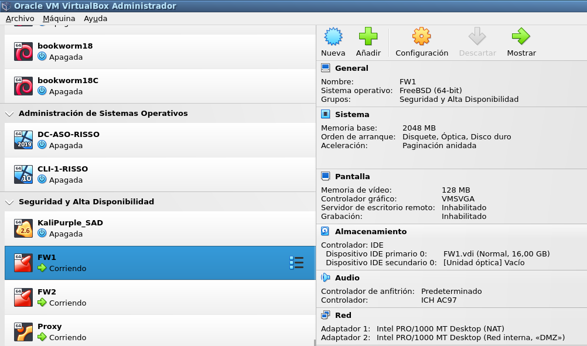
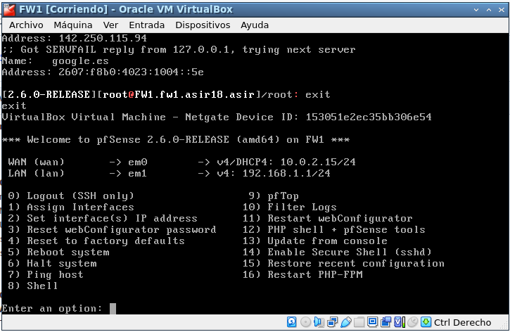
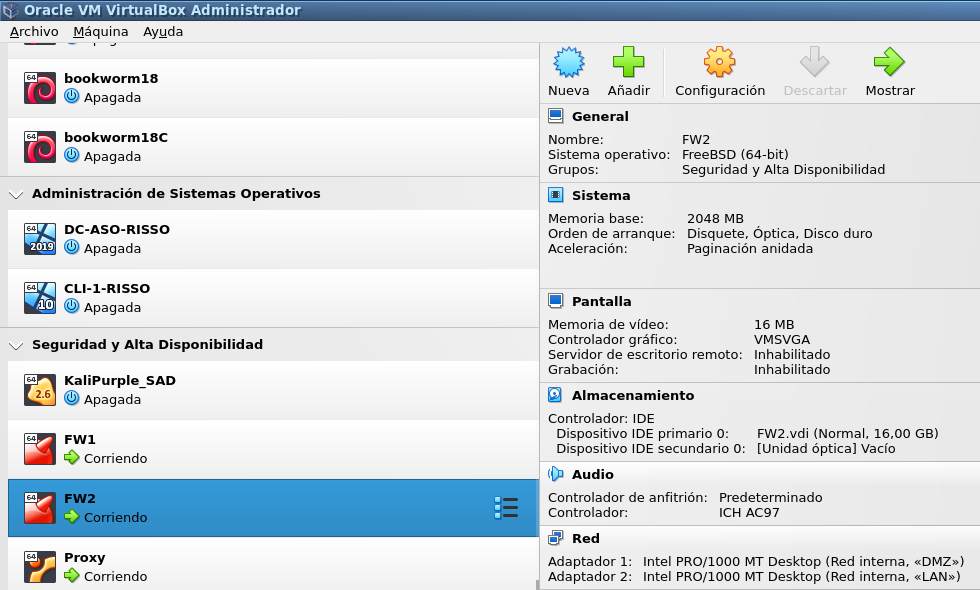
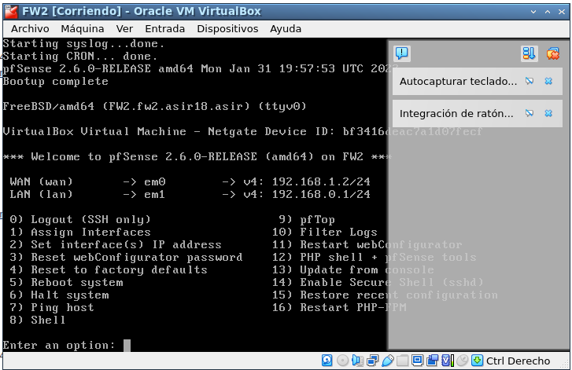
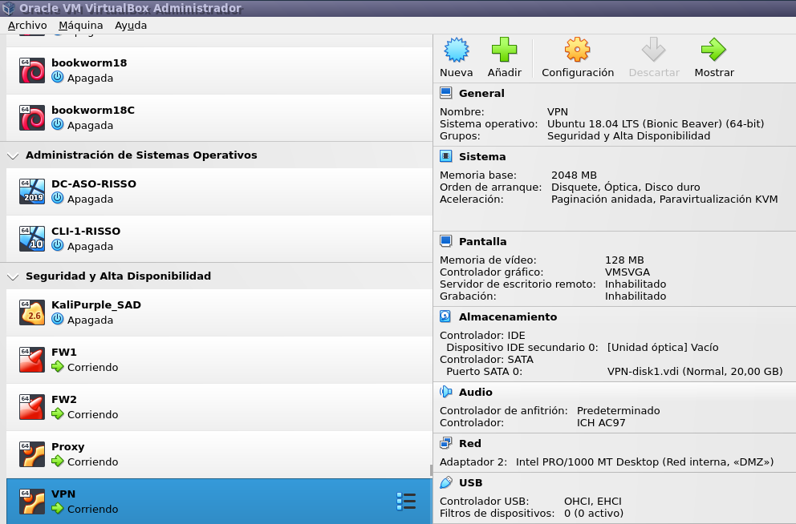
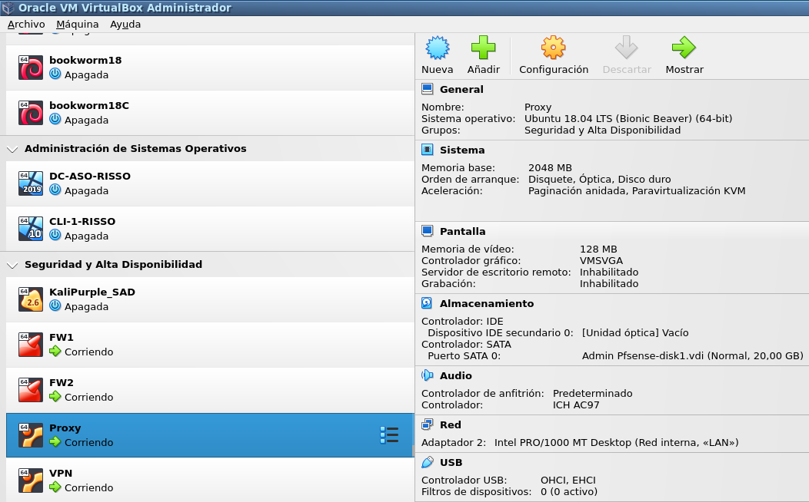
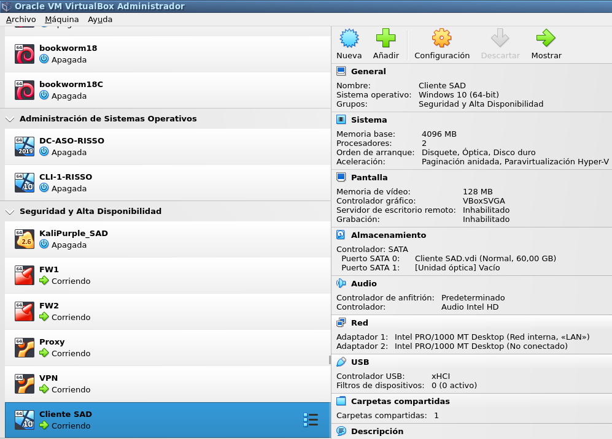

# 2. Máquinas en VirtualBox

Cinco máquinas virtuales. Los recursos son los que muestran las capturas del laboratorio (el número de vCPU no aparece en todas; se asume 1 salvo en el cliente).

| VM | Sistema | RAM | Disco | Adaptador 1 | Adaptador 2 |
|----|---------|-----|-------|-------------|-------------|
| **FW1** | pfSense 2.6.0 (FreeBSD 64-bit) | 2 GB | 16 GB | Red NAT (WAN) | Red interna `DMZ` |
| **FW2** | pfSense 2.6.0 (FreeBSD 64-bit) | 2 GB | 16 GB | Red interna `DMZ` | Red interna `LAN` |
| **VPN** | Ubuntu Server 18.04 | 2 GB | 20 GB | Red interna `DMZ` | — |
| **Proxy** | Ubuntu Server 18.04 | 2 GB | 20 GB | Red interna `LAN` | — |
| **Cliente** | Windows 10 | 4 GB (2 vCPU) | 60 GB | Red interna `LAN` | — |

> Las redes internas de VirtualBox (`DMZ` y `LAN`) aíslan el tráfico: dos VM solo se ven si comparten el mismo nombre de red interna. Así los firewalls son el único camino entre zonas.

## FW1 — firewall externo

Tipo *FreeBSD (64-bit)*, ISO de pfSense del sitio oficial. Adaptador 1 en **Red NAT** (acceso a Internet) y adaptador 2 en **Red interna `DMZ`**.

Consola de pfSense con la WAN en `em0` (DHCP) y la interfaz hacia la DMZ en `em1` (`192.168.1.1/24`); desde la propia consola se resuelve `google.es`, por lo que tiene salida a Internet:

## FW2 — firewall interno

Adaptador 1 en **Red interna `DMZ`** y adaptador 2 en **Red interna `LAN`**.

En la consola: `em0` (WAN de pfSense = DMZ) con `192.168.1.2/24` y `em1` (LAN) con `192.168.0.1/24`.

## Servidor VPN

Ubuntu Server en la red interna `DMZ`.

## Servidor Proxy

Ubuntu Server en la red interna `LAN`.

## Cliente interno

Windows 10 en la red interna `LAN`.

