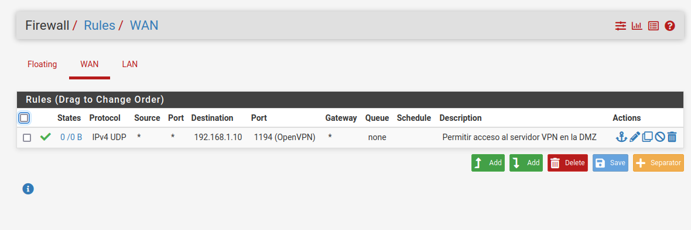
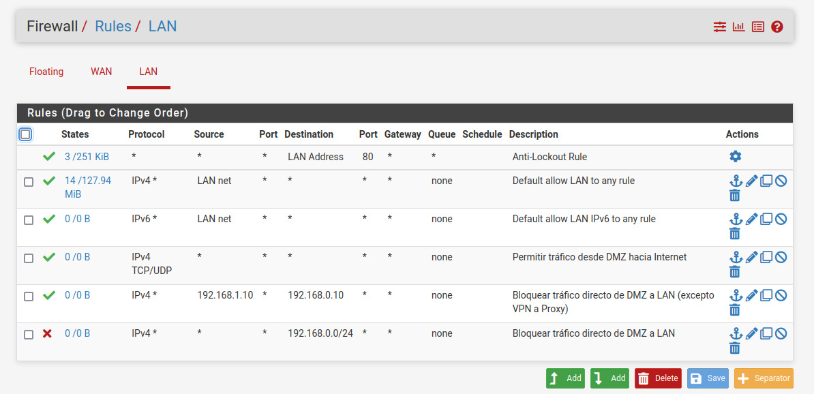
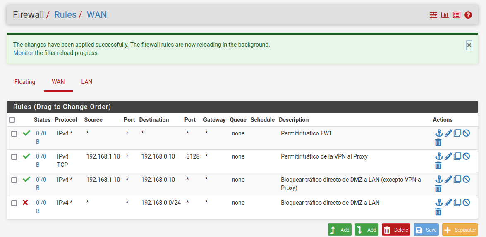
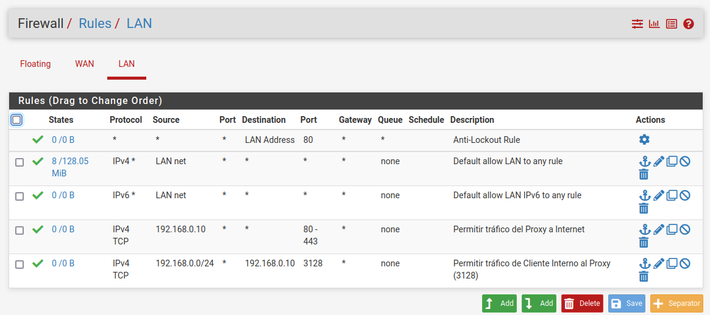

# 3. Firewalls pfSense

Las reglas de pfSense se evalúan **de arriba abajo por interfaz de entrada** y se aplica la primera que coincide; lo que no coincide con ninguna se **deniega**. Por eso las excepciones (*pass*) van **por encima** de los bloqueos.

> ℹ️ Recuerda: en FW1 la pestaña *LAN* de pfSense es la **DMZ**; en FW2 la pestaña *WAN* es la **DMZ** y *LAN* es la LAN real (ver [arquitectura](./01-arquitectura.md#zonas-de-seguridad)).

## 3.1 FW1 — firewall externo

### Reglas de la práctica

| Interfaz | Acción | Proto | Origen | Destino | Puerto | Descripción |
|----------|--------|-------|--------|---------|--------|-------------|
| WAN | Pass | UDP | * | `192.168.1.10` | 1194 | Permitir acceso al servidor VPN en la DMZ |
| DMZ (*LAN*) | Pass | TCP/UDP | * | * | * | Permitir tráfico de la DMZ hacia Internet |
| DMZ (*LAN*) | Pass | * | `192.168.1.10` | `192.168.0.10` | * | Excepción VPN → Proxy |
| DMZ (*LAN*) | Block (desactivada) | * | * | `192.168.0.0/24` | * | Bloquear DMZ → LAN |

**NAT:** *Outbound NAT* en modo automático, que traduce `192.168.1.0/24` a la IP de la WAN (masquerade).

### Qué falta o se puede mejorar

- **Port forward:** una regla de *firewall* en la WAN solo **permite** el tráfico; para que el cliente VPN llegue de verdad a `192.168.1.10` hay que crear además un **NAT → Port Forward** (WAN, UDP 1194 → `192.168.1.10:1194`) y, en VirtualBox, reenviar el puerto de la red NAT hacia la IP WAN de FW1.
- **Redes privadas en la WAN:** como en el laboratorio la WAN es una red privada, hay que desmarcar *Block private networks and loopback addresses* en *Interfaces → WAN*; si no, pfSense descarta el tráfico entrante.
- **Reglas de bloqueo DMZ → LAN:** el bloqueo de la LAN se aplica en **FW2**; en FW1 no hay LAN, así que esas reglas sobran.
- **Ruta estática:** para que el servidor VPN alcance `192.168.0.0/24`, necesita una ruta vía FW2 (`192.168.1.2`): en FW1 (*System → Routing → Static Routes*) o en el propio servidor VPN (`ip route add 192.168.0.0/24 via 192.168.1.2`).

## 3.2 FW2 — firewall interno

### Reglas de la práctica

**Interfaz DMZ (*WAN* de pfSense)**

| Acción | Proto | Origen | Destino | Puerto | Descripción |
|--------|-------|--------|---------|--------|-------------|
| Pass | IPv4 * | * | * | * | "Permitir tráfico FW1" |
| Pass | TCP | `192.168.1.10` | `192.168.0.10` | 3128 | Permitir tráfico de la VPN al Proxy |
| Pass | IPv4 * | `192.168.1.10` | `192.168.0.10` | * | Excepción VPN → Proxy |
| Block (desactivada) | IPv4 * | * | `192.168.0.0/24` | * | Bloquear DMZ → LAN |

**Interfaz LAN**

| Acción | Proto | Origen | Destino | Puerto | Descripción |
|--------|-------|--------|---------|--------|-------------|
| Pass | * | * | `LAN Address` | 80 | Anti-lockout |
| Pass | IPv4 / IPv6 | `LAN net` | * | * | *Default allow LAN to any* |
| Pass | TCP | `192.168.0.10` | * | 80–443 | Permitir tráfico del Proxy a Internet |
| Pass | TCP | `192.168.0.0/24` | `192.168.0.10` | 3128 | Permitir Cliente interno → Proxy |

**NAT:** *Outbound NAT* automático.

### Puntos débiles detectados

Revisando las capturas se aprecian dos huecos respecto al diseño que se pretendía:

1. **La regla *Pass* genérica en la interfaz DMZ** (`*` → `*`) permite todo el tráfico DMZ → LAN y anula el aislamiento. Además, el bloqueo DMZ → LAN estaba **desactivado**. La prueba de `ping` desde la VPN ([ver pruebas](./06-pruebas.md)) no es concluyente: Windows 10 bloquea el ICMP entrante por defecto.
2. **La regla *Default allow LAN to any*** deja salir a los clientes directamente a Internet sin pasar por el proxy (la prueba de `tracert` los muestra saliendo por FW2 → FW1 → `8.8.8.8`).

## 3.3 Reglas recomendadas (FW2)

**Interfaz DMZ** — orden de arriba a abajo:

| # | Acción | Proto | Origen | Destino | Puerto |
|---|--------|-------|--------|---------|--------|
| 1 | Pass | TCP | `192.168.1.10` | `192.168.0.10` | 3128 |
| 2 | Block (con *log*) | * | * | `192.168.0.0/24` | * |

**Interfaz LAN** — desactivar *Default allow LAN to any* y dejar:

| # | Acción | Proto | Origen | Destino | Puerto |
|---|--------|-------|--------|---------|--------|
| 1 | Pass | TCP | `192.168.0.0/24` | `192.168.0.10` | 3128 |
| 2 | Pass | TCP | `192.168.0.10` | * | 80, 443 |
| 3 | Pass | UDP/TCP | `192.168.0.10` | * | 53 (DNS del proxy) |

Con esto los clientes solo pueden usar Internet a través del proxy y la DMZ solo llega al `3128` del proxy. Tras aplicarlas, las pruebas de [conectividad y seguridad](./06-pruebas.md) deben repetirse para confirmarlo.

➡️ Siguiente: [4. Proxy Squid](./04-proxy-squid.md)
