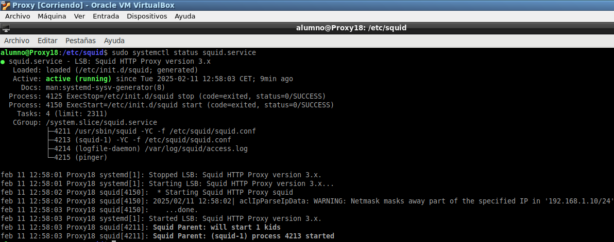
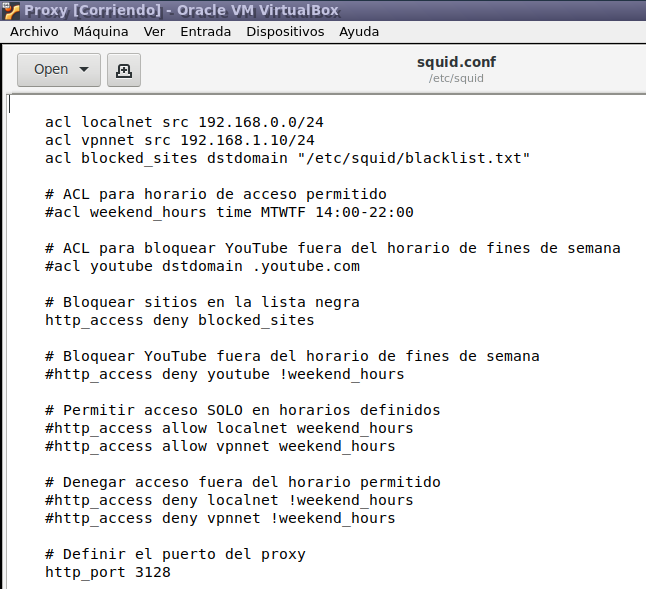
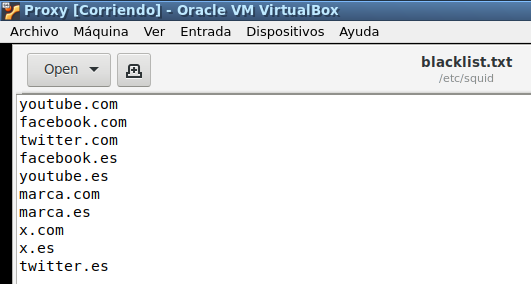
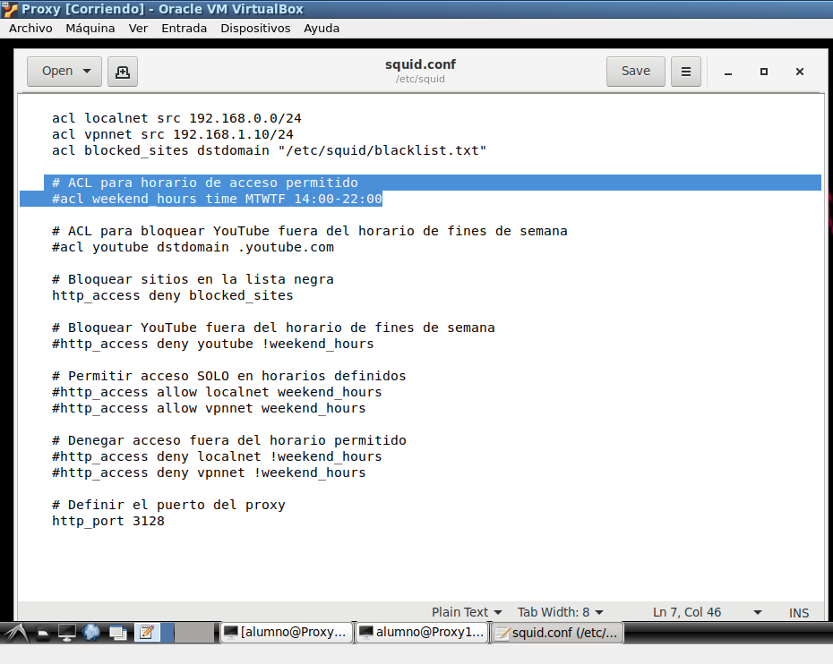

# 4. Proxy Squid

El proxy (`192.168.0.10`, puerto `3128`) es el único camino a Internet para la red interna. Además de ocultar a los clientes, permite **bloquear sitios**, **limitar por horario** y **auditar** el tráfico en `access.log`.

## 4.1 Instalación

```bash
sudo apt update && sudo apt upgrade -y
sudo apt install squid -y
sudo systemctl status squid
```



## 4.2 Configuración de la práctica

Se edita `/etc/squid/squid.conf`:

```bash
sudo nano /etc/squid/squid.conf
```



```text
acl localnet src 192.168.0.0/24
acl vpnnet src 192.168.1.10/24
acl blocked_sites dstdomain "/etc/squid/blacklist.txt"

http_access deny blocked_sites
http_access allow localnet
http_access deny all
http_port 3128
```

> ⚠️ Al arrancar, Squid avisa: `Netmask masks away part of the specified IP in '192.168.1.10/24'` (visible en la captura del estado del servicio). La ACL `vpnnet` debe ser `192.168.1.10/32`; además, en la práctica **nunca se usaba** en un `http_access allow`, por lo que el tráfico de la VPN no estaba realmente permitido.

### Lista negra

`/etc/squid/blacklist.txt`, un dominio por línea:



> ⚠️ En `dstdomain`, `facebook.com` coincide **solo con ese nombre exacto**, no con `www.facebook.com`. Para bloquear también los subdominios hay que poner el punto inicial: `.facebook.com`. En los logs de la práctica se ve el problema: `facebook.com:443` aparece como `TCP_DENIED` pero `www.facebook.com:443` como `TCP_TUNNEL/200` (permitido). Ver [pruebas](./06-pruebas.md#b-bloqueo-de-sitios).

### Restricciones de horario

```text
acl working_hours time MTWHF 08:00-18:00
http_access allow localnet working_hours
http_access deny localnet !working_hours
```

Los días en Squid son `S` (domingo), `M`, `T`, `W`, `H` (jueves), `F` y `A` (sábado). Combinar una ACL de tiempo con una de dominios permite reglas del tipo *"bloquear YouTube fuera del horario laboral"*:

```text
acl youtube dstdomain .youtube.com
http_access deny youtube !working_hours
```



> ⚠️ En la práctica la ACL se escribió `time MTWTF 14:00-22:00` (con `T` dos veces): el segundo `T` es martes, no jueves, así que el jueves quedaba sin cubrir. Debe ser `MTWHF`.

## 4.3 Configuración mejorada

El fichero [`configs/squid.conf`](../configs/squid.conf) recoge las correcciones: ACL de la VPN con `/32` y realmente permitida, subdominios bloqueados, días de la semana correctos, restricción de puertos seguros (`80`/`443`) y orden de reglas coherente (lo más restrictivo, primero). La lista negra mejorada está en [`configs/blacklist.txt`](../configs/blacklist.txt).

```bash
sudo cp /etc/squid/squid.conf /etc/squid/squid.conf.bak
sudo cp squid.conf /etc/squid/squid.conf
sudo cp blacklist.txt /etc/squid/blacklist.txt
sudo squid -k parse          # valida la sintaxis
sudo systemctl restart squid
sudo systemctl enable squid
```

> 💡 El orden de las reglas `http_access` importa: Squid aplica la **primera** que coincide, por eso los `deny` específicos (lista negra, horarios) van antes del `allow` general y `deny all` va el último.

## 4.4 Cliente interno

En el navegador (o por GPO/WPAD en un entorno real):

```text
Proxy HTTP: 192.168.0.10
Puerto:     3128
```

## 4.5 Registros

```bash
sudo tail -f /var/log/squid/access.log
```

Cada línea muestra la hora (epoch), la IP del cliente, el resultado (`TCP_TUNNEL/200` permitido, `TCP_DENIED/403` bloqueado) y el destino.

➡️ Siguiente: [5. Servidor VPN](./05-vpn-openvpn.md)
