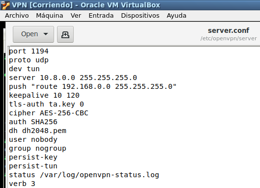
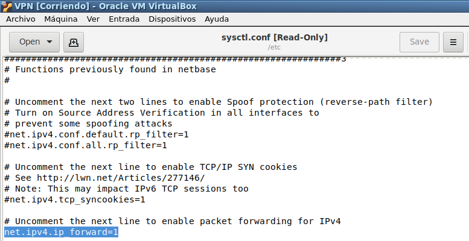
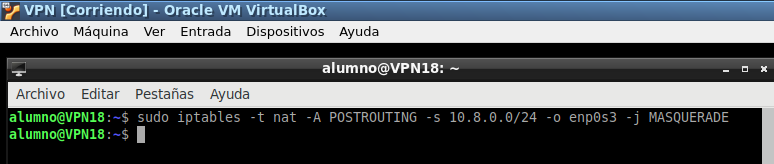
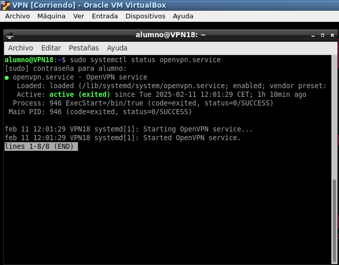

# 5. Servidor VPN (OpenVPN en la DMZ)

El servidor VPN (`192.168.1.10`) es el único equipo accesible desde Internet. Escucha en **UDP 1194** y crea el túnel `10.8.0.0/24`. A los clientes se les envía la ruta hacia `192.168.0.0/24`, pero gracias al NAT y a las reglas de FW2 **solo podrán llegar al proxy (TCP 3128)**.

## 5.1 Instalación

```bash
sudo apt update
sudo apt install openvpn easy-rsa -y
```

## 5.2 Infraestructura de clave pública (Easy-RSA)

La práctica original no documentó la creación de certificados. Procedimiento con Easy-RSA 3:

```bash
make-cadir ~/openvpn-ca && cd ~/openvpn-ca
./easyrsa init-pki
./easyrsa build-ca nopass                 # autoridad certificadora
./easyrsa gen-req server nopass           # petición del servidor
./easyrsa sign-req server server          # firma del certificado del servidor
./easyrsa gen-dh                          # parámetros Diffie-Hellman
openvpn --genkey --secret ta.key          # clave TLS-Auth

./easyrsa gen-req cliente1 nopass         # un certificado por cliente
./easyrsa sign-req client cliente1

sudo cp pki/ca.crt pki/dh.pem ta.key pki/issued/server.crt pki/private/server.key /etc/openvpn/
```

> 🔐 `ca.key`, `server.key` y los certificados de cliente **no deben subirse nunca a un repositorio**. Protege `pki/private/` con permisos restrictivos.

## 5.3 Configuración del servidor

[`configs/openvpn-server.conf`](../configs/openvpn-server.conf) → `/etc/openvpn/server.conf`. Parámetros principales:

| Parámetro | Valor | Significado |
|-----------|-------|-------------|
| `port` / `proto` | `1194` / `udp` | Puerto del servicio |
| `dev` | `tun` | Túnel enrutado (capa 3) |
| `server` | `10.8.0.0 255.255.255.0` | Red del túnel |
| `push "route …"` | `192.168.0.0 255.255.255.0` | Ruta que reciben los clientes hacia la LAN |
| `tls-auth` | `ta.key 0` | Protección adicional del canal de control |
| `cipher` / `auth` | `AES-256-GCM` / `SHA256` | Cifrado (la práctica original usaba `AES-256-CBC`) |
| `user` / `group` | `nobody` / `nogroup` | El proceso pierde privilegios tras arrancar |



## 5.4 Reenvío de paquetes y NAT

Hay que activar el reenvío de IPv4 descomentando en `/etc/sysctl.conf`:

```text
net.ipv4.ip_forward=1
```



Y enmascarar el tráfico del túnel hacia la DMZ. Así FW2 ve la IP `192.168.1.10` —la única autorizada hacia el proxy— y no la de cada cliente VPN:

```bash
sudo iptables -t nat -A POSTROUTING -s 10.8.0.0/24 -o enp0s3 -j MASQUERADE
```



> ⚠️ El nombre de la interfaz depende del sistema: en la práctica era `enp0s3`, no `eth0`. Compruébalo con `ip -br a`.

El script [`configs/vpn-nat.sh`](../configs/vpn-nat.sh) hace ambas cosas de forma idempotente. Para que la regla sobreviva al reinicio: `sudo apt install iptables-persistent && sudo netfilter-persistent save`.

## 5.5 Arranque del servicio

```bash
sudo systemctl enable --now openvpn@server
sudo systemctl status openvpn@server
```



> ⚠️ La captura muestra `openvpn.service` como *active (exited)*: es la unidad "paraguas", que siempre aparece así. La instancia real del túnel es **`openvpn@server`**; es la que hay que comprobar.

## 5.6 Cliente VPN

Fichero `.ovpn` del cliente (los certificados pueden ir en línea o en ficheros aparte):

```text
client
dev tun
proto udp
remote <IP-pública-o-WAN-de-FW1> 1194
nobind
persist-key
persist-tun
remote-cert-tls server
cipher AES-256-GCM
auth SHA256
ca ca.crt
cert cliente1.crt
key cliente1.key
tls-auth ta.key 1
```

Una vez conectado, el cliente VPN recibe una IP `10.8.x.x` y puede usar el proxy `192.168.0.10:3128`.

> 📝 **Pendiente:** la práctica original no incluye una prueba de conexión de un cliente VPN real. Queda como trabajo futuro y es el siguiente paso lógico para validar el escenario completo (ver [problemas y mejoras](./07-problemas-y-mejoras.md)).

➡️ Siguiente: [6. Pruebas](./06-pruebas.md)
