# 6. Pruebas

Resumen de lo que se comprobó en el laboratorio y qué mostraron las capturas.

| Prueba | Resultado esperado | Resultado | Estado |
|--------|--------------------|-----------|--------|
| Navegación permitida vía proxy | Acceso correcto | `google.es` carga; `TCP_TUNNEL/200` en el log | ✅ |
| Bloqueo de sitios (lista negra) | Acceso rechazado | `marca.es` y `facebook.com` bloqueados (`TCP_DENIED/403`); `www.facebook.com` se colaba | ⚠️ corregido en `configs/` |
| Restricción horaria | Bloqueo fuera de horario | `google.es` rechazado fuera de la franja | ✅ |
| DMZ → LAN (`ping` desde la VPN) | Bloqueado | Sin respuesta | ⚠️ no concluyente |
| SSH al proxy | Solo desde orígenes autorizados | Se conecta desde FW2 | ℹ️ falta probar desde la DMZ |
| Ruta del tráfico (`tracert`) | Sale por los firewalls | `192.168.0.1` → `192.168.1.1` → `8.8.8.8` | ⚠️ evidencia de salida directa |
| Resolución DNS | Correcta | `nslookup www.google.com` resuelve vía `8.8.8.8` | ✅ |
| Conexión de un cliente VPN | Túnel establecido | — | 📝 pendiente |

## Pruebas del proxy

### a) Navegación permitida

Desde el cliente (`192.168.0.100`) con el proxy configurado, se accede a un sitio permitido:

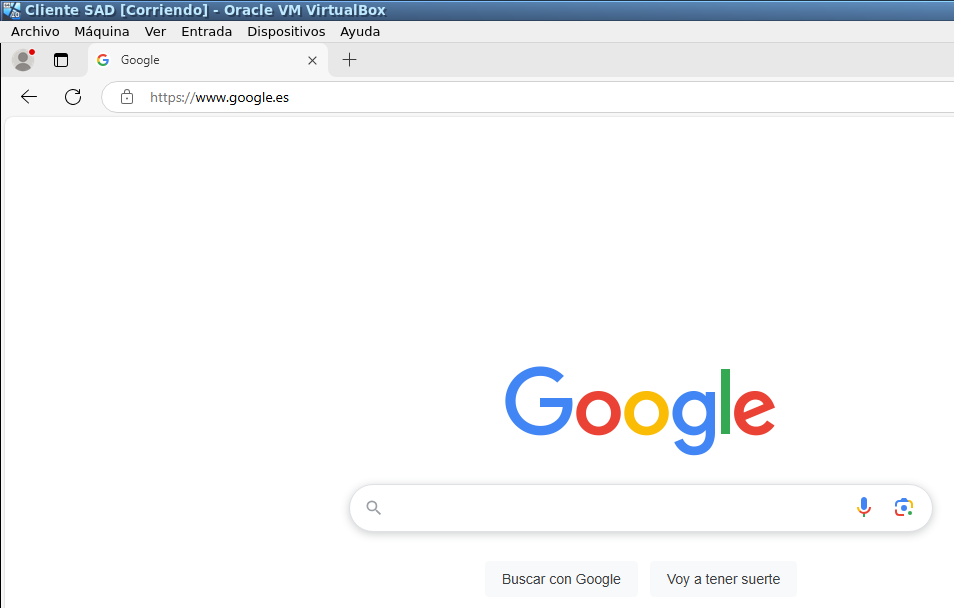

En el servidor proxy, `sudo tail -f /var/log/squid/access.log` debe mostrar las peticiones con la IP `192.168.0.100` y resultado `TCP_TUNNEL/200`:

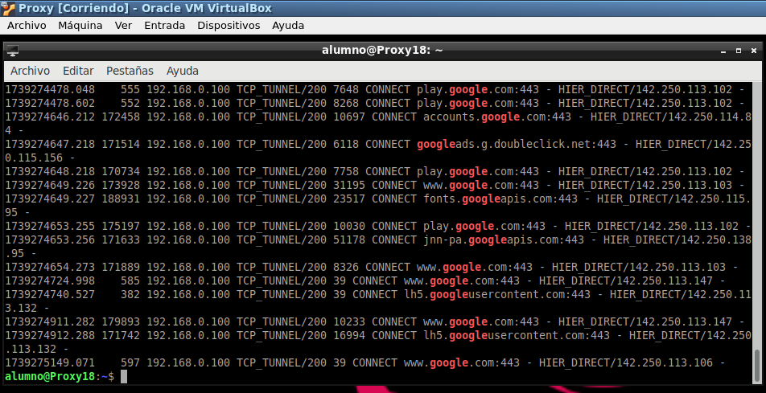

### b) Bloqueo de sitios

Se intenta acceder a sitios de la lista negra. El proxy devuelve una página de error (*Acceso Denegado*):

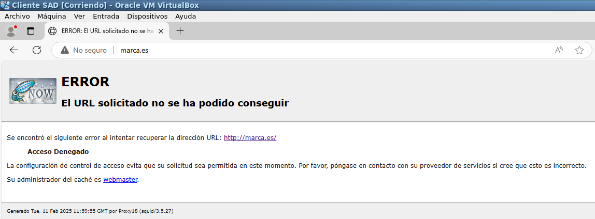

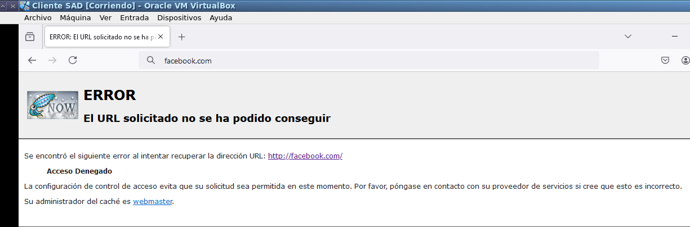

En el log, las peticiones aparecen como `TCP_DENIED/403` (`grep facebook /var/log/squid/access.log`):

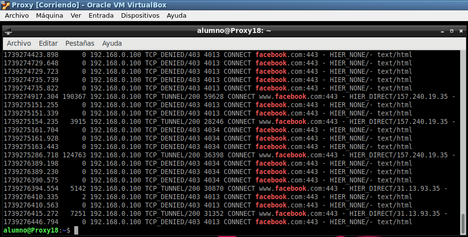

> ⚠️ En el mismo log se ve también `www.facebook.com:443` con `TCP_TUNNEL/200` (permitido) mezclado con los bloqueos de `facebook.com:443`. La causa es que la lista negra usaba `facebook.com` (coincidencia exacta) en lugar de `.facebook.com` (dominio y subdominios). Corregido en [`configs/blacklist.txt`](../configs/blacklist.txt).

### c) Restricciones de tiempo

Con una ACL de horario activa y la prueba hecha fuera de la franja permitida, el acceso se rechaza:

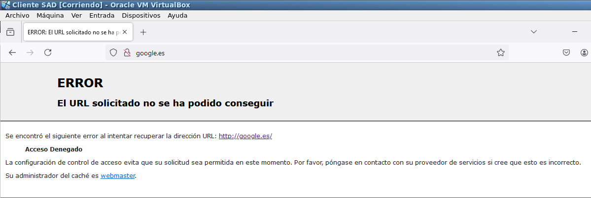

El log muestra `TCP_DENIED/403` para `google.es`, y de nuevo `TCP_TUNNEL/200` cuando se restablece el acceso:

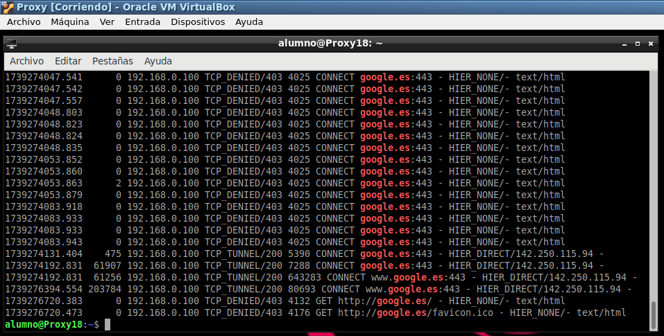

### Verificación del tráfico en el proxy

Todo el tráfico web del cliente queda registrado en el proxy:

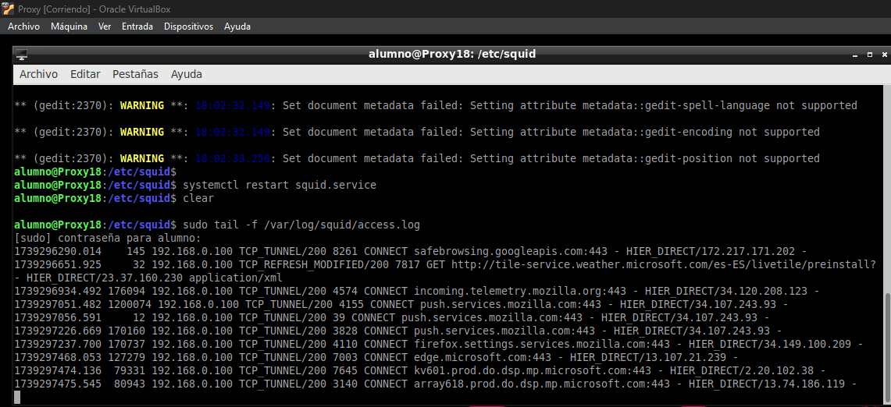

## Pruebas de seguridad

### Aislamiento DMZ → LAN

Desde el servidor VPN (`192.168.1.10`):

```bash
ping 192.168.0.100
```

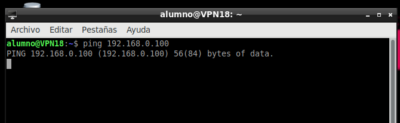

> ⚠️ **No concluyente:** Windows 10 descarta el ICMP entrante por defecto, así que la falta de respuesta no demuestra que el firewall bloquee. Una prueba válida es intentar un puerto abierto en el cliente (p. ej. `nc -zv 192.168.0.100 445`) y revisar los logs de FW2, o habilitar temporalmente el *ping* en el cliente. Con las [reglas recomendadas](./03-firewalls-pfsense.md#33-reglas-recomendadas-fw2), solo debe pasar `192.168.1.10 → 192.168.0.10:3128`.

### SSH al proxy

La captura muestra una sesión SSH al proxy abierta **desde FW2**, que sí tiene acceso:

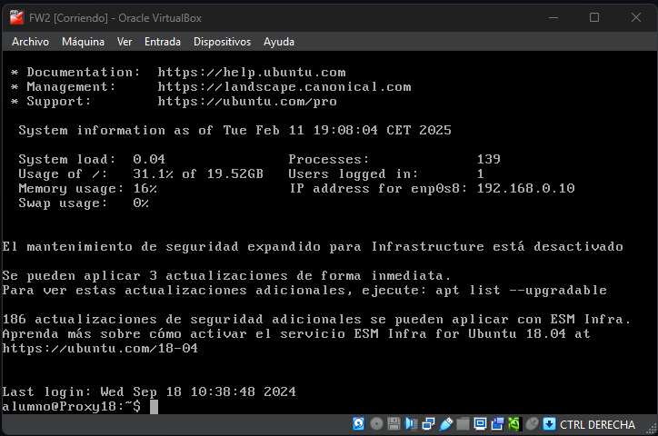

La prueba pendiente es repetirla **desde el servidor VPN** (`ssh usuario@192.168.0.10`), que debe fallar: FW2 solo permite el puerto `3128` desde la DMZ.

### Ruta del tráfico

```cmd
tracert 8.8.8.8
```

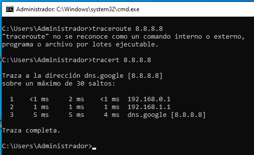

El tráfico sale por `192.168.0.1` (FW2) → `192.168.1.1` (FW1) → destino. Es **la ruta de los firewalls**, no la del proxy: el proxy actúa a nivel de aplicación y no aparece como salto. Además, que esta prueba funcione demuestra que el cliente podía salir **sin pasar por el proxy**, algo que las [reglas recomendadas](./03-firewalls-pfsense.md#33-reglas-recomendadas-fw2) eliminan.

### DNS

```cmd
nslookup www.google.com
```

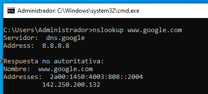

Resuelve correctamente usando `8.8.8.8` directamente (de nuevo, sin pasar por el proxy).

## Pruebas pendientes tras aplicar las mejoras

- [ ] `curl -x http://192.168.0.10:3128 http://www.facebook.com` devuelve `403`; `.facebook.com` cubre subdominios.
- [ ] Un cliente interno **sin** proxy configurado no tiene salida a Internet.
- [ ] Desde la VPN: `nc -zv 192.168.0.10 3128` ✅ y `nc -zv 192.168.0.10 22` ❌; ningún otro host de la LAN es alcanzable.
- [ ] Un cliente OpenVPN real se conecta por UDP 1194 y navega a través del proxy.

➡️ Siguiente: [7. Problemas y mejoras](./07-problemas-y-mejoras.md)
