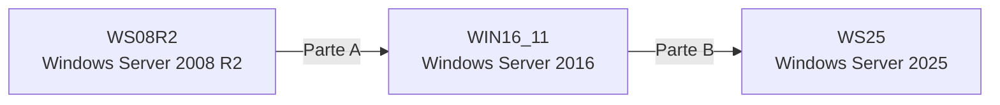

# 🪟 Migración de Active Directory: Windows Server 2008 R2 → 2016 → 2025

Guía paso a paso, con capturas, de la migración de un controlador de dominio de **Windows Server 2008 R2** a **Windows Server 2025**, pasando por **Windows Server 2016** como servidor intermedio. Se realizó en un laboratorio con el dominio `risso.loc` (octubre de 2025).

## 🎯 Qué se hizo

- Instalar el servidor nuevo, unirlo al dominio y promocionarlo a controlador de dominio adicional.
- Transferir los **5 roles FSMO** (por interfaz gráfica, `ntdsutil` y PowerShell).
- Degradar y retirar el servidor antiguo (AD DS, DNS, salida del dominio).
- Elevar los **niveles funcionales** del bosque y el dominio.
- Comprobar la migración de **SYSVOL de FRS a DFSR**.
- Repetir el proceso de 2016 a 2025.

## 📖 Guía

| # | Documento | Contenido |
|---|-----------|-----------|
| 0 | [Entorno y requisitos](./docs/00-entorno-y-requisitos.md) | Escenario, requisitos y visión general |
| 1 | [Preparar el servidor 2016](./docs/01-preparar-servidor-2016.md) | SMB 1.0, UAC, unión al dominio, rol AD DS, promoción a DC |
| 2 | [Transferir roles FSMO](./docs/02-transferir-roles-fsmo.md) | Los 5 roles, GUI, `ntdsutil` y PowerShell |
| 3 | [Retirar Windows Server 2008 R2](./docs/03-retirar-ws2008r2.md) | `dcpromo`, quitar DNS, salir del dominio |
| 4 | [Niveles funcionales y SYSVOL](./docs/04-niveles-funcionales-y-sysvol.md) | Elevar niveles, catálogo global, FRS → DFSR |
| 5 | [Migración 2016 → 2025](./docs/05-migracion-2016-a-2025.md) | Mismo proceso con PowerShell y limpieza final |
| 6 | [Problemas y soluciones](./docs/06-problemas-y-soluciones.md) | Errores reales encontrados y lecciones aprendidas |
| 7 | [Referencia de comandos](./docs/07-comandos-referencia.md) | Chuleta de comandos |

## 🗂️ Contenido de la carpeta

- [`docs/`](./docs): documentación por fases.
- [`scripts/`](./scripts): scripts de PowerShell ([`verificar-estado-ad.ps1`](./scripts/verificar-estado-ad.ps1), [`transferir-roles-fsmo.ps1`](./scripts/transferir-roles-fsmo.ps1)).
- [`evidencias/`](./evidencias): capturas de pantalla numeradas, referenciadas desde la documentación.

> ⚠️ Documentación elaborada en un laboratorio. En un entorno de producción haz siempre copia de seguridad del estado del sistema y prueba el proceso antes.
