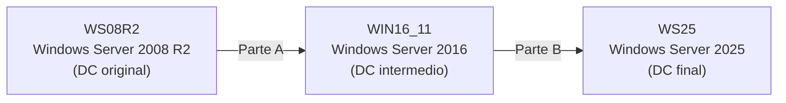

# 0. Entorno y requisitos

## Escenario del laboratorio

Se migra un dominio de Active Directory (`msm.loc`) desde un controlador de dominio con **Windows Server 2008 R2** hasta **Windows Server 2025**, pasando por **Windows Server 2016** como servidor intermedio.



| Servidor | Sistema operativo | Papel |
|----------|-------------------|-------|
| `WS08R2.msm.loc` | Windows Server 2008 R2 | DC original, poseedor de los 5 roles FSMO, DNS |
| `WIN16_11.msm.loc` | Windows Server 2016 | DC intermedio |
| `WS25.msm.loc` | Windows Server 2025 | DC final |

- **Dominio / bosque:** `msm.loc`
- **Nivel funcional inicial del bosque:** Windows Server 2003
- **Nivel funcional final:** Windows Server 2025

> 💡 **Por qué una migración *side-by-side*:** no se actualiza el sistema operativo "en el sitio". Se instala un servidor nuevo, se une al dominio existente como controlador de dominio adicional, se le traspasan los roles y finalmente se retira el antiguo. Así el servicio no se interrumpe y siempre se puede volver atrás mientras el servidor viejo siga encendido.

## Requisitos previos

En cada salto (2008 R2 → 2016 y 2016 → 2025) hace falta:

- [ ] Un servidor **nuevo ya instalado** con la versión de destino, activado, con IP fija, DNS apuntando al DC actual y nombre definitivo.
- [ ] Credenciales de **administrador del dominio** (y de *Enterprise Admins* / *Schema Admins* para tocar el esquema).
- [ ] Reloj sincronizado entre los servidores (Kerberos tolera poca desviación).
- [ ] **Copia de seguridad** del estado del sistema del DC antiguo (o snapshot si es una VM).
- [ ] Estado de AD sano antes de empezar (ver [verificación previa](#verificación-previa)).

## Visión general del proceso

| Fase | Qué se hace | Documento |
|------|-------------|-----------|
| **A. 2008 R2 → 2016** | | |
| 1 | Preparar el servidor 2016, unirlo al dominio y promocionarlo a DC | [01](./01-preparar-servidor-2016.md) |
| 2 | Transferir los 5 roles FSMO | [02](./02-transferir-roles-fsmo.md) |
| 3 | Retirar el DC 2008 R2 | [03](./03-retirar-ws2008r2.md) |
| 4 | Subir niveles funcionales y migrar SYSVOL de FRS a DFSR | [04](./04-niveles-funcionales-y-sysvol.md) |
| **B. 2016 → 2025** | | |
| 5 | Repetir el proceso con Windows Server 2025 | [05](./05-migracion-2016-a-2025.md) |
| — | Problemas encontrados | [06](./06-problemas-y-soluciones.md) |
| — | Referencia rápida de comandos | [07](./07-comandos-referencia.md) |

## Verificación previa

Antes de tocar nada, en el DC actual (como administrador, en una consola elevada):

```cmd
dcdiag /v
repadmin /replsummary
netdom query fsmo
dfsrmig /getglobalstate
```

Un fichero [`scripts/verificar-estado-ad.ps1`](../scripts/verificar-estado-ad.ps1) agrupa estas comprobaciones en el servidor nuevo (con el módulo de Active Directory).
