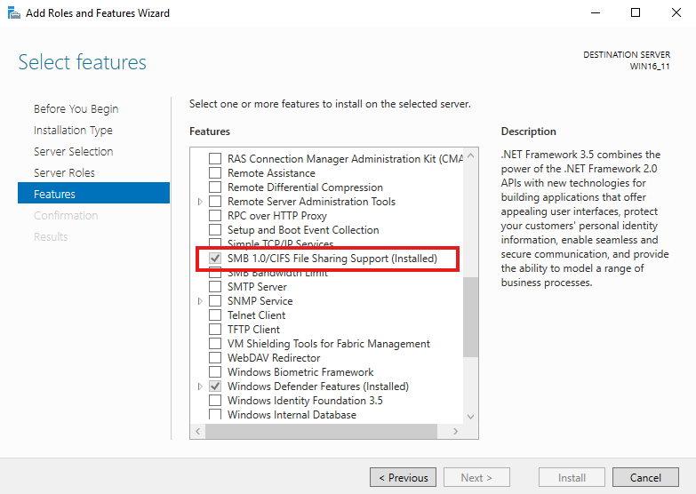
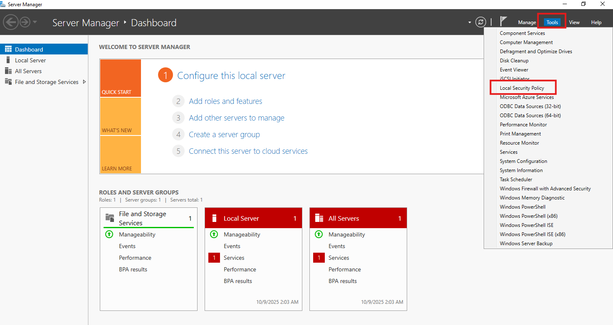
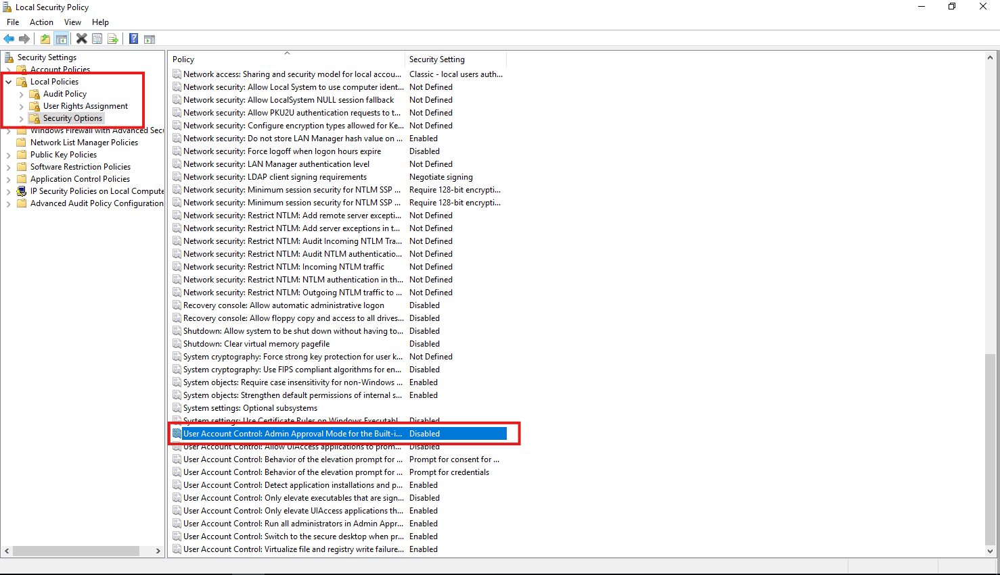
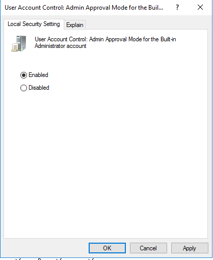
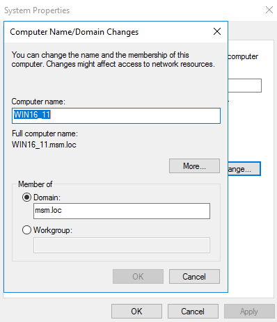
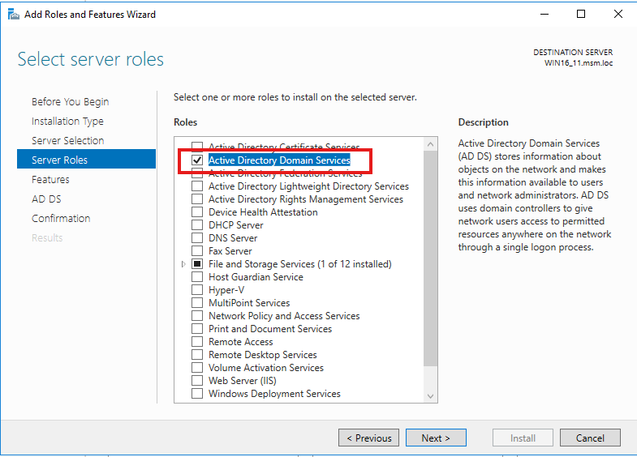
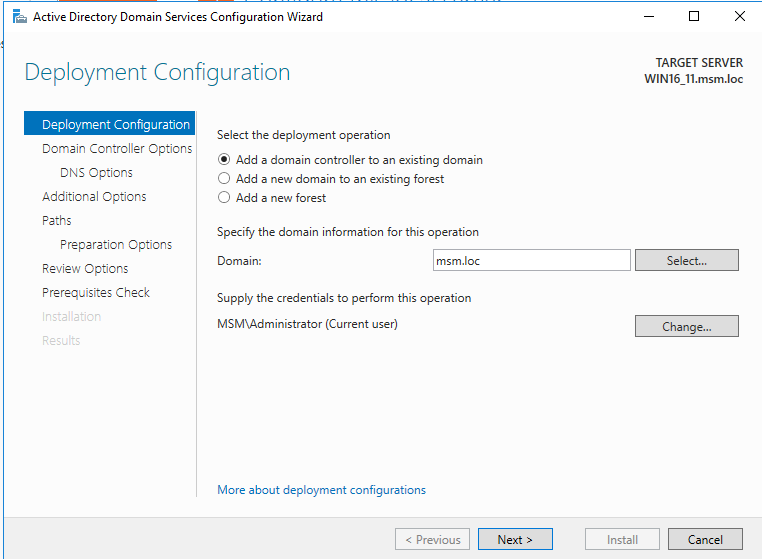

# 1. Preparar el servidor Windows Server 2016

Objetivo: dejar el servidor nuevo unido al dominio `risso.loc` y convertido en **controlador de dominio adicional**.

> Prerrequisitos básicos: Windows activado, IP fija con el DNS apuntando al DC antiguo, nombre definitivo del equipo. Ver [requisitos](./00-entorno-y-requisitos.md).

## 1.1 Habilitar SMB 1.0/CIFS (solo si hay equipos antiguos)

En **Add Roles and Features → Features** se marca *SMB 1.0/CIFS File Sharing Support*.



**¿Por qué?** Durante la migración puede haber equipos antiguos (Windows XP, Windows 7 sin actualizar, NAS o aplicaciones *legacy*) que solo hablan SMB 1.0. Sin él fallan al conectarse al nuevo servidor (*"no se puede acceder al recurso compartido"*).

> ⚠️ **Seguridad:** SMB 1.0 es un protocolo obsoleto y vulnerable. Habilítalo **solo si realmente lo necesitas** y desactívalo al terminar la migración (`Disable-WindowsOptionalFeature -Online -FeatureName SMB1Protocol` o quitando la característica desde el asistente). Windows Server 2008 R2 ya soporta SMB 2, por lo que para la migración en sí no es imprescindible.

## 1.2 Ajustar la directiva de seguridad local

Abre **Server Manager → Tools → Local Security Policy**.



En **Local Policies → Security Options** localiza:

> **User Account Control: Admin Approval Mode for the Built-in Administrator account**

Esta política controla cómo se comporta la cuenta *Administrador* integrada frente al Control de cuentas de usuario (UAC).



Se establece en **Enabled**:



## 1.3 Unir el servidor al dominio

*System Properties → Change… → Member of → Domain* y escribir `risso.loc`. Reinicia e inicia sesión con un **administrador del dominio**.



```powershell
# Equivalente en PowerShell
Add-Computer -DomainName risso.loc -Credential RISSO\Administrator -Restart
```

> 💡 Recomendación: evita guiones bajos (`_`) en el nombre del equipo (en el laboratorio se usó `WIN16_11`). No es un nombre DNS válido según RFC y puede dar problemas de resolución; usa guiones normales (`WIN16-11`).

## 1.4 Instalar el rol Active Directory Domain Services

*Add Roles and Features → Server Roles → Active Directory Domain Services*.



```powershell
Install-WindowsFeature AD-Domain-Services -IncludeManagementTools
```

## 1.5 Promocionar a controlador de dominio

Tras instalar el rol, usa **Promote this server to a domain controller** y elige **Add a domain controller to an existing domain** (no un bosque nuevo). El dominio es `risso.loc` y las credenciales, las del administrador del dominio.



En el resto del asistente:

- Mantén marcado **DNS Server** y **Global Catalog**.
- Define la contraseña del modo de restauración de servicios de directorio (DSRM) y guárdala de forma segura.
- Revisa el *Prerequisites Check* y pulsa **Install**. El servidor se reiniciará.

```powershell
# Equivalente en PowerShell
Install-ADDSDomainController -DomainName risso.loc -InstallDns -Credential (Get-Credential)
```

### Comprobación

Tras reiniciar, `repadmin /replsummary` debe mostrar replicación sin errores y el nuevo servidor aparecerá en *Active Directory Users and Computers → Domain Controllers*.

➡️ Siguiente: [2. Transferir los roles FSMO](./02-transferir-roles-fsmo.md)
