# 2. Transferir los roles FSMO

Los **Operations Masters** (roles **FSMO**, *Flexible Single Master Operations*) son funciones críticas de Active Directory que en cada momento solo puede ejercer **un** controlador de dominio. Hay 5: dos a nivel de **bosque** y tres a nivel de **dominio**. Todos están en el servidor antiguo (`WS08R2`) y hay que pasarlos al nuevo (`WIN16_11`) **antes** de retirar el antiguo.

| Rol | Ámbito | Función |
|-----|--------|---------|
| **Schema Master** | Bosque | Es el único que puede modificar el esquema de AD. |
| **Domain Naming Master** | Bosque | Añade o elimina dominios y particiones del bosque. |
| **RID Master** | Dominio | Reparte bloques de RID a los DC para construir los SID de nuevos objetos. Si se agotan, no se pueden crear objetos. |
| **PDC Emulator** | Dominio | Fuente de hora del dominio, cambios de contraseña inmediatos, bloqueo de cuentas y primer destino de las GPO. Emula un PDC de NT por compatibilidad. |
| **Infrastructure Master** | Dominio | Mantiene referencias de objetos entre dominios. No debe residir en un DC que sea Catálogo Global, salvo que todos lo sean. |

> 💡 Hay dos formas de hacerlo: **interfaz gráfica + `ntdsutil`** (lo que se hizo en el laboratorio, paso a paso abajo) o **un solo comando de PowerShell** (ver [2.5](#25-alternativa-rápida-con-powershell)). Si sólo quieres hacerlo rápido, ve directamente a la 2.5.

## 2.1 Roles de dominio: RID, PDC e Infrastructure

En **Active Directory Users and Computers**, clic derecho sobre el dominio → **Operations Masters…**

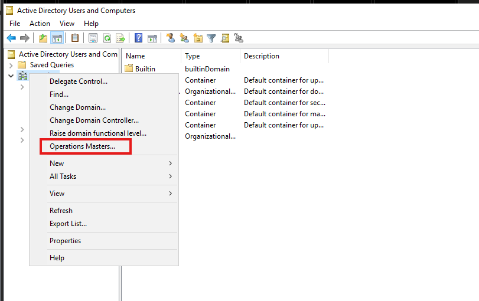

Hay una pestaña por rol. En cada una, comprueba que el maestro actual es `WS08R2.msm.loc`, selecciona el servidor nuevo y pulsa **Change…**

**RID Master**

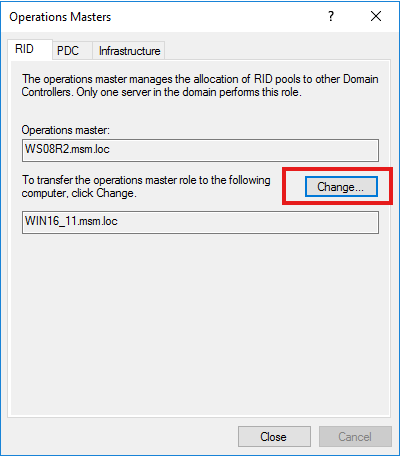

**PDC Emulator**

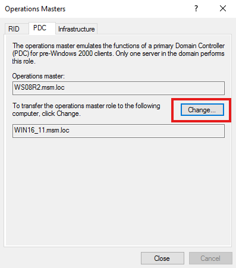

**Infrastructure Master**

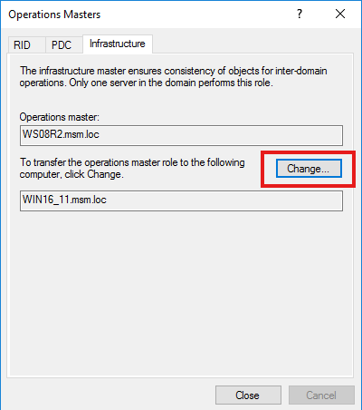

### Comprobación intermedia

```cmd
netdom query fsmo
```

Ahora RID, PDC e Infrastructure deben apuntar a `WIN16_11`, mientras que *Schema* y *Domain Naming* siguen en `WS08R2`:

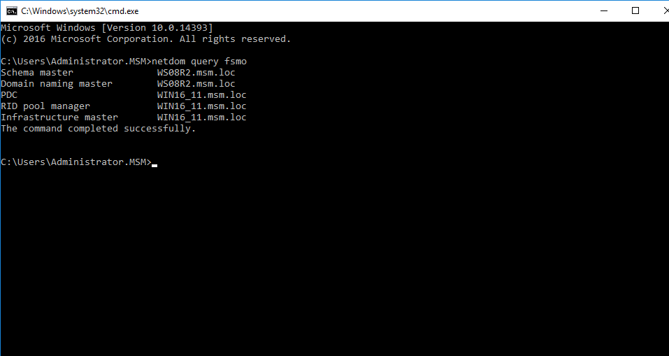

## 2.2 Domain Naming Master

Se cambia desde **Active Directory Domains and Trusts** (Server Manager → Tools).

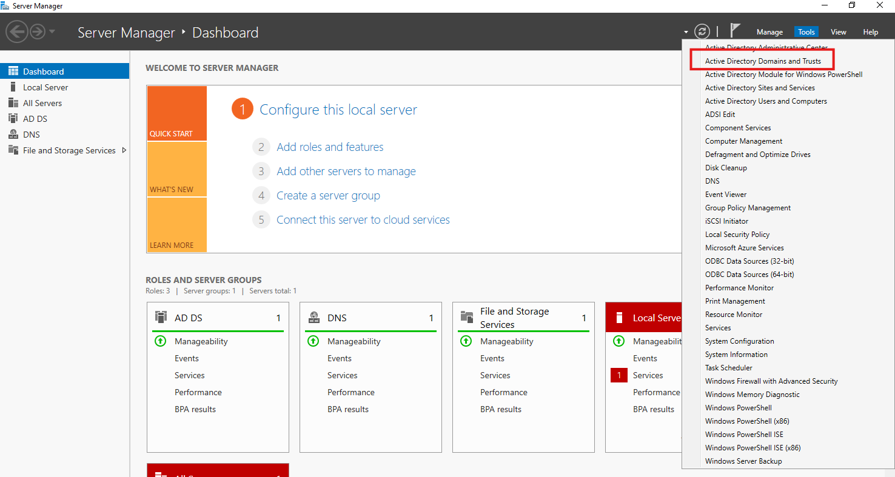

Clic derecho sobre la raíz → **Operations Master…** → **Change…**

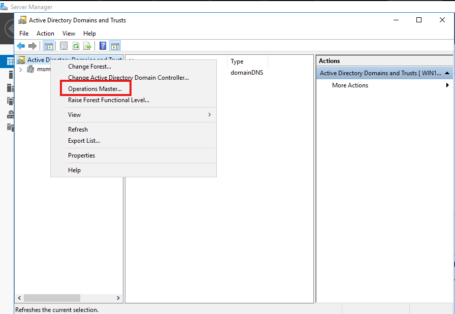

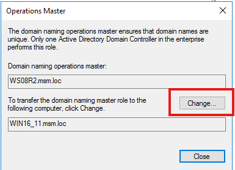

## 2.3 Schema Master (con `ntdsutil`)

El Schema Master no se puede transferir desde ninguna consola gráfica "normal", así que se usa **`ntdsutil`**, una utilidad de línea de comandos para administración y mantenimiento avanzado de AD. Se ejecuta **desde el DC antiguo** (`WS08R2`) en una consola como administrador.

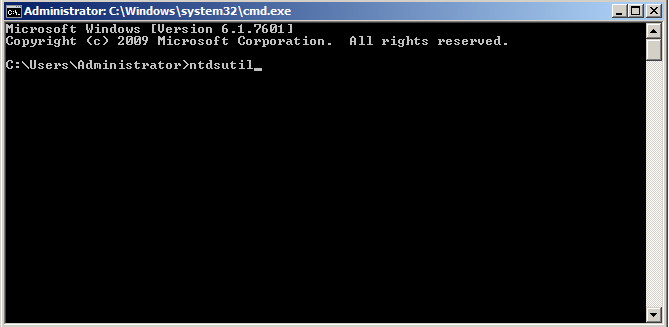

Secuencia de comandos:

```text
ntdsutil
roles
connections
connect to server WIN16_11.msm.loc
quit
transfer schema master
quit
quit
```

1. `roles` entra en el menú *fsmo maintenance*.

   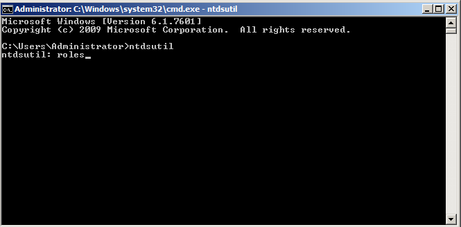

2. `connections` → `connect to server <FQDN del servidor nuevo>` para conectar con el servidor destino.

   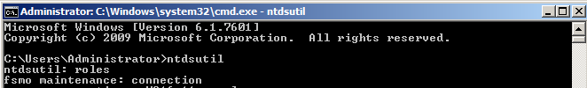

   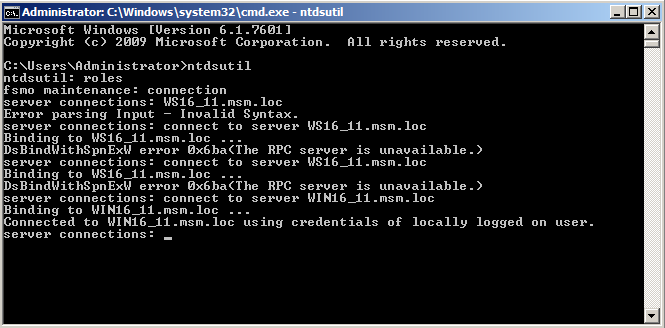

   > ⚠️ Escribe el **nombre completo y correcto** del servidor. En el laboratorio, el primer intento falló con *"RPC server is unavailable"* por un nombre mal escrito (`WS16_11` en vez de `WIN16_11`); ver [problemas](./06-problemas-y-soluciones.md#1-ntdsutil-invalid-syntax--rpc-server-is-unavailable).

3. `quit` para salir del menú de conexiones y `transfer schema master` para traspasar el rol.

   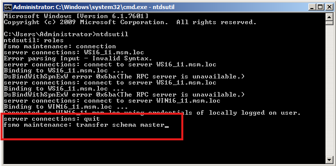

4. `quit` dos veces para salir de `ntdsutil`. Confirma el cuadro de diálogo de seguridad que aparece al transferir.

## 2.4 Verificación

```cmd
netdom query fsmo
```

Los cinco roles deben aparecer en `WIN16_11.msm.loc`.

## 2.5 Alternativa rápida con PowerShell

Con el módulo de Active Directory (`Import-Module ActiveDirectory`), los cinco roles se transfieren con una sola orden. Los números son los de la enumeración `ADOperationMasterRole`:

| Número | Rol |
|--------|-----|
| 0 | PDCEmulator |
| 1 | RIDMaster |
| 2 | InfrastructureMaster |
| 3 | SchemaMaster |
| 4 | DomainNamingMaster |

```powershell
Move-ADDirectoryServerOperationMasterRole -Identity WIN16_11 -OperationMasterRole 0,1,2,3,4 -Confirm:$false
```

Funciona igual en Windows Server 2016 y 2025. Se incluye en [`scripts/transferir-roles-fsmo.ps1`](../scripts/transferir-roles-fsmo.ps1).

➡️ Siguiente: [3. Retirar el servidor Windows Server 2008 R2](./03-retirar-ws2008r2.md)
