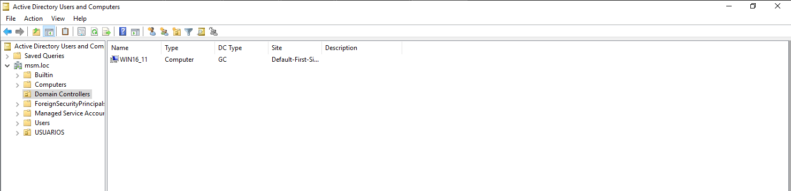
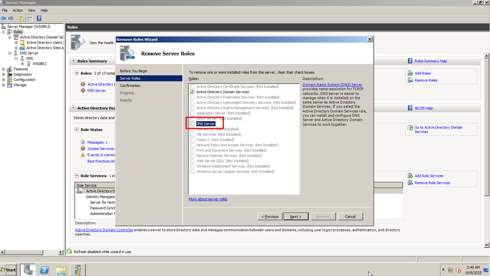

# 3. Retirar el servidor Windows Server 2008 R2

Con los cinco roles FSMO ya en el servidor nuevo, el DC antiguo puede jubilarse.

## 3.0 Antes de empezar

- [ ] `netdom query fsmo` muestra **todos** los roles en el servidor nuevo.
- [ ] El servidor nuevo es **Catálogo Global** (ver [4.4](./04-niveles-funcionales-y-sysvol.md#44-comprobar-el-catálogo-global)) y tiene el rol **DNS**.
- [ ] Los clientes, servidores y ámbitos DHCP usan como DNS el servidor nuevo (y no solo el antiguo). El propio servidor nuevo debe tener su DNS apuntando a sí mismo / a otro DC.
- [ ] Tienes una copia de seguridad o snapshot del servidor antiguo.

## 3.1 Degradar el controlador de dominio

En el servidor 2008 R2, ejecuta `dcpromo` (como administrador) y sigue el asistente para **quitar Active Directory Domain Services** sin marcar "este es el último controlador de dominio".

Al terminar, el servidor pasa a ser un servidor miembro.

## 3.2 Comprobar desde el servidor nuevo

En **Active Directory Users and Computers → Domain Controllers** solo debe aparecer el servidor nuevo:

## 3.3 Quitar el rol DNS del servidor antiguo

En Server Manager (2008 R2) → **Remove Roles** y desmarca **DNS Server**.

## 3.4 Sacarlo del dominio y apagarlo

Pasa el servidor antiguo a un grupo de trabajo (*System Properties → Change… → Workgroup*) y reinicia. Después ya puede **apagarse**: no se volverá a usar.

> 💡 Prudencia: no lo borres de inmediato. Déjalo apagado unos días por si hace falta recuperar algo; cuando todo esté validado, elimina la VM o reformatea el equipo.

➡️ Siguiente: [4. Niveles funcionales y SYSVOL](./04-niveles-funcionales-y-sysvol.md)
