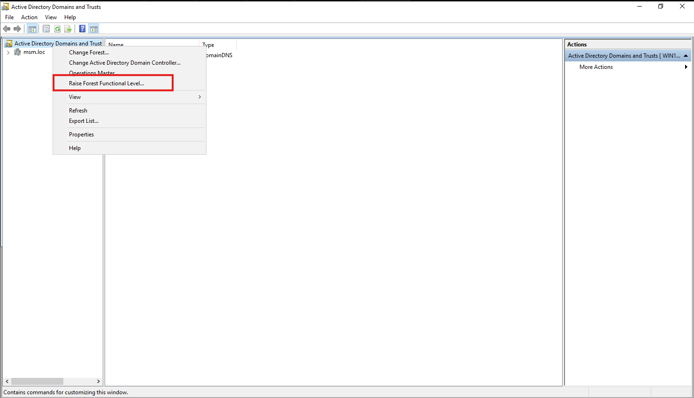
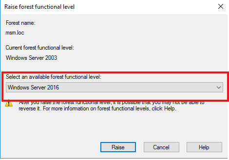
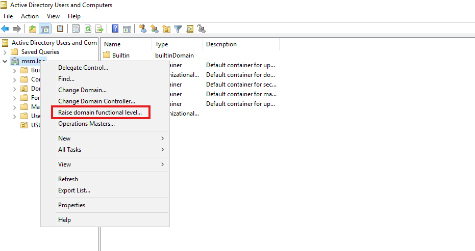
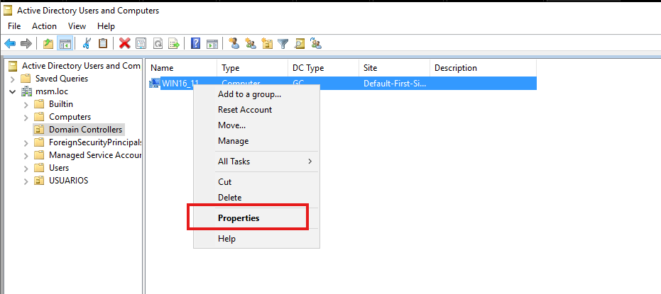
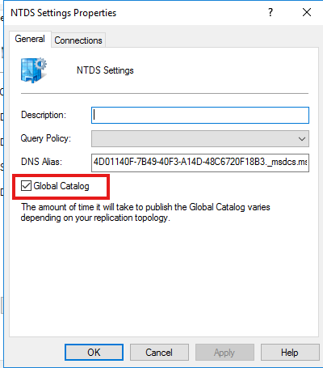
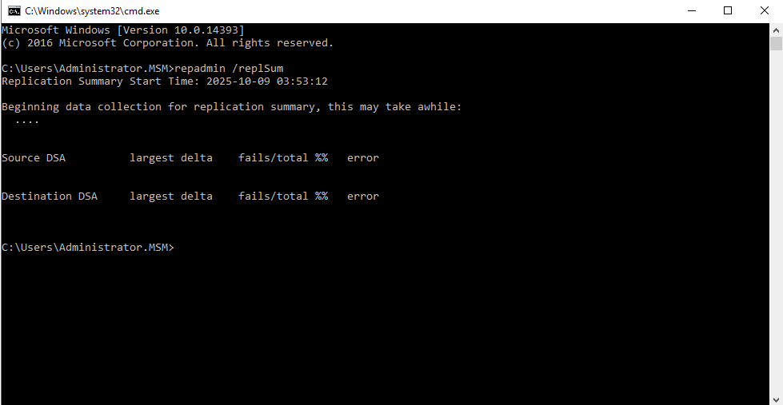
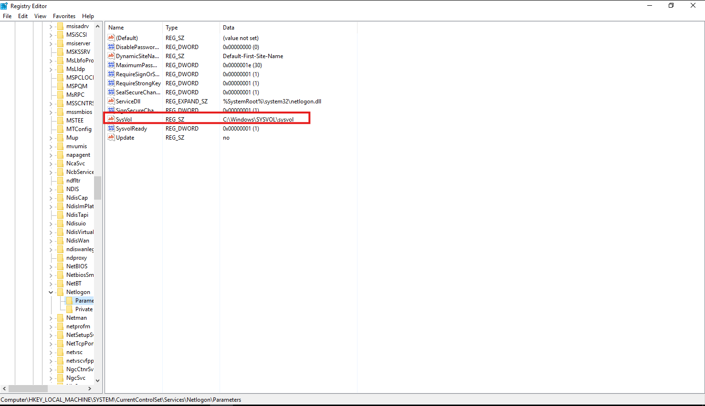
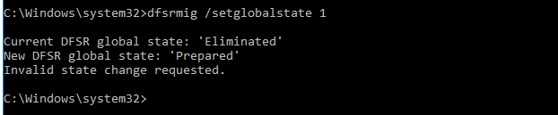
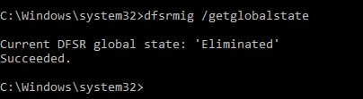
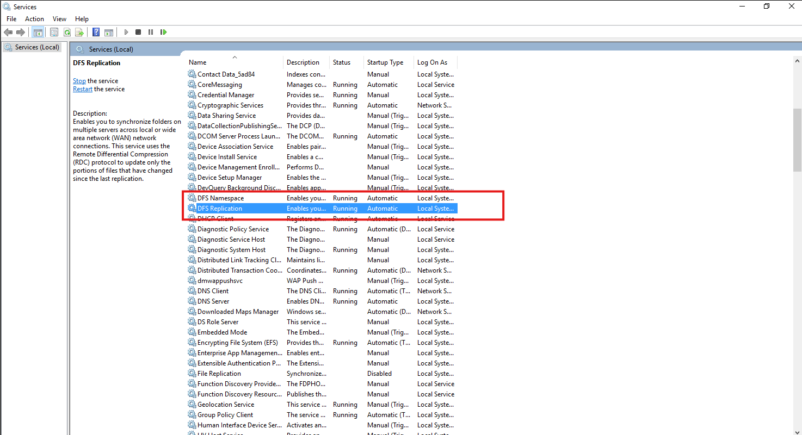

# 4. Niveles funcionales y migración de SYSVOL (FRS → DFSR)

## 4.1 ¿Por qué subir el nivel funcional?

El nivel funcional del dominio y del bosque determina qué funciones de AD están disponibles y qué versiones mínimas de Windows Server pueden ser controladores de dominio. Subirlo permite:

- Habilitar funciones nuevas de AD que solo existen a partir de ciertas versiones de Windows Server.
- Dejar de dar compatibilidad a controladores antiguos, de modo que AD pueda usar versiones más recientes de los protocolos de replicación, autenticación y administración.
- Mejorar la seguridad, el rendimiento y la estabilidad.

> ⚠️ **Subir el nivel funcional no se puede revertir de forma sencilla.** Hazlo solo cuando no queden DC con versiones inferiores (aquí, tras retirar `WS08R2`) y con copia de seguridad.

## 4.2 Subir el nivel funcional del bosque

En **Active Directory Domains and Trusts** → clic derecho sobre la raíz → **Raise Forest Functional Level…**



El bosque estaba en *Windows Server 2003*. Se selecciona **Windows Server 2016** (el nivel del servidor actual) y se pulsa **Raise**.



## 4.3 Subir el nivel funcional del dominio

En **Active Directory Users and Computers** → clic derecho sobre el dominio → **Raise Domain Functional Level…**



> Al elevar el bosque suele elevarse también el dominio, pero conviene comprobarlo y hacerlo si no es así.

## 4.4 Comprobar el catálogo global

En *Active Directory Users and Computers → Domain Controllers*, clic derecho sobre el DC → **Properties** y verifica que la casilla **Global Catalog** está marcada (la columna *DC Type* también debe mostrar `GC`). Es imprescindible antes de retirar el DC antiguo.





## 4.5 Estado de la replicación

```cmd
repadmin /replsummary
```

Muestra un resumen del estado de replicación entre DC. Con un único DC la tabla sale vacía, sin errores:



## 4.6 Migrar SYSVOL de FRS a DFSR

**SYSVOL** (scripts de inicio de sesión y GPO) se replicaba con el antiguo **FRS** (*File Replication Service*). Los controladores modernos solo soportan **DFSR** (*Distributed File System Replication*), por lo que hay que migrar. La herramienta es `dfsrmig`, que se ejecuta con una consola **como administrador**.

> 💡 **Orden recomendado:** comprueba el estado de SYSVOL **antes** de promocionar el primer DC moderno, ya que los servidores recientes exigen DFSR. En el laboratorio ya se encontraba en el estado final, como se ve abajo.

### Estados de la migración

| Estado | Nombre | Significado |
|--------|--------|-------------|
| 0 | Start | Se usa FRS |
| 1 | Prepared | Se crea la copia de SYSVOL para DFSR; FRS sigue sirviendo |
| 2 | Redirected | DFSR sirve SYSVOL; FRS sigue replicando la copia antigua |
| 3 | Eliminated | Solo DFSR; FRS desactivado (estado final) |

```cmd
dfsrmig /getglobalstate
dfsrmig /getmigrationstate
dfsrmig /setglobalstate 1
dfsrmig /setglobalstate 2
dfsrmig /setglobalstate 3
```

Entre cada paso espera a que `dfsrmig /getmigrationstate` indique que **todos los DC** han alcanzado el estado.

### Lo que ocurrió en el laboratorio

1. Se comprobó en el registro que SYSVOL apuntaba a la carpeta correcta y estaba lista:
   `HKLM\SYSTEM\CurrentControlSet\Services\Netlogon\Parameters` → `SysVol` = `C:\Windows\SYSVOL\sysvol` y `SysvolReady` = `1`.

   

2. Al intentar `dfsrmig /setglobalstate 1` se obtuvo *"Invalid state change requested"*:

   

3. Al consultar el estado se vio que el estado global **ya era `Eliminated`**, es decir, la migración ya estaba completada y no había nada que hacer:

   

4. Se verificó que los servicios **DFS Replication** y **DFS Namespace** estaban en ejecución con inicio automático:

   

```powershell
Get-Service DFSR, DFS | Select-Object Name, Status, StartType
```

✅ Con esto, el dominio queda migrado de Windows Server 2008 R2 a Windows Server 2016.

➡️ Siguiente: [5. Migración de 2016 a 2025](./05-migracion-2016-a-2025.md)
