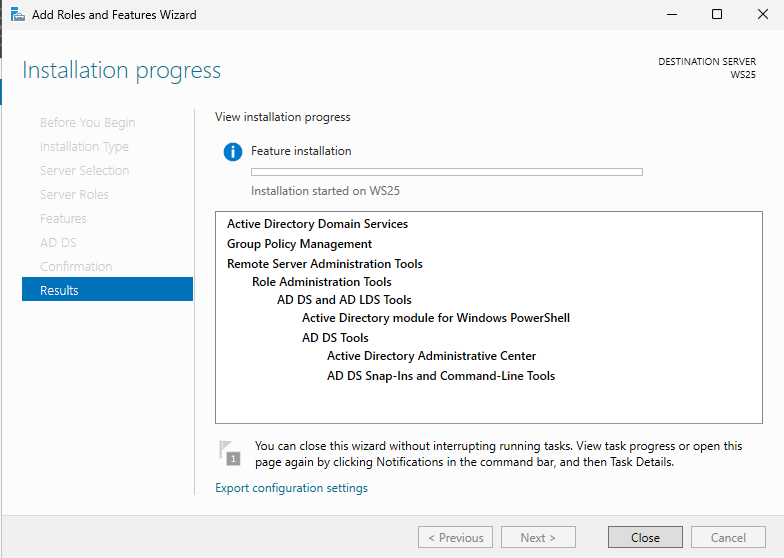
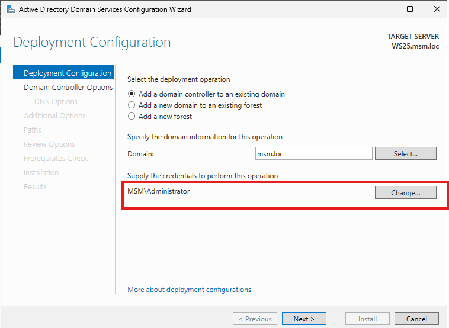
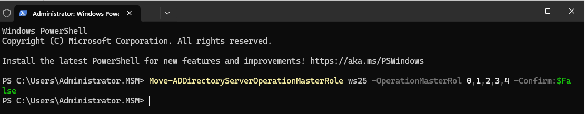
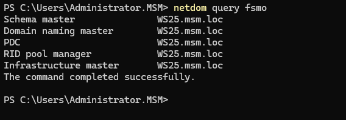
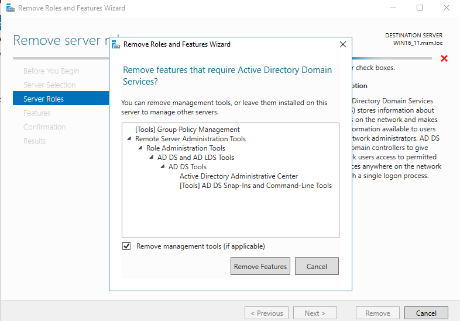
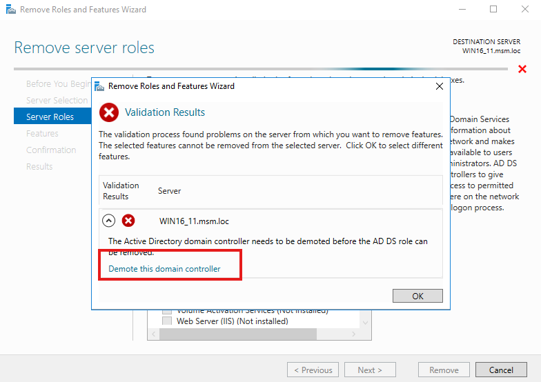
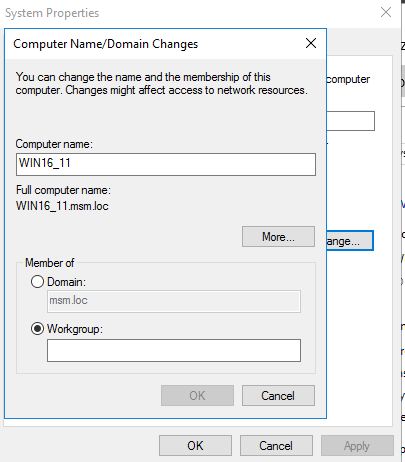
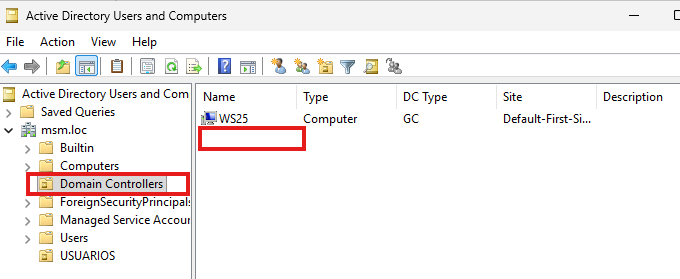
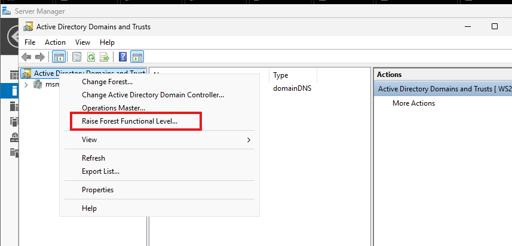
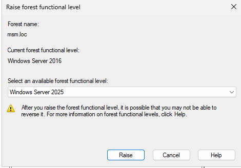

# 5. Migración de Windows Server 2016 a Windows Server 2025

El proceso es el mismo que en la parte A, con dos simplificaciones: los roles FSMO se transfieren con **un solo comando de PowerShell** y no hace falta tocar SYSVOL (ya usa DFSR).

## 5.1 Preparar el servidor 2025

Con el servidor `WS25` instalado, activado y con IP fija (DNS apuntando al DC actual), instala el rol **Active Directory Domain Services** y únelo al dominio `risso.loc`.



```powershell
Install-WindowsFeature AD-Domain-Services -IncludeManagementTools
```

## 5.2 Promocionar a controlador de dominio

Elige **Add a domain controller to an existing domain**. Hay que indicar las credenciales de un usuario del dominio con permisos (p. ej. `RISSO\Administrator`); sin ellas el asistente no deja continuar.



## 5.3 Transferir los roles FSMO

Desde PowerShell, con un solo comando se mueven los cinco roles al nuevo servidor:

```powershell
Move-ADDirectoryServerOperationMasterRole WS25 -OperationMasterRole 0,1,2,3,4 -Confirm:$false
```



Se comprueba con `netdom query fsmo` que todos los roles están en `WS25.risso.loc`:



> La tabla con el significado de los números (0–4) está en [2.5](./02-transferir-roles-fsmo.md#25-alternativa-rápida-con-powershell).

## 5.4 Retirar el servidor 2016

Antes: `WS25` debe ser Catálogo Global y servir DNS, y los clientes deben usarlo como DNS. Después:

1. **Degradar el DC.** Si intentas quitar directamente el rol AD DS desde *Remove Roles and Features*:

   

   el asistente da error porque **primero hay que degradar el controlador de dominio** (enlace *Demote this domain controller*):

   

   ```powershell
   Uninstall-ADDSDomainController -DemoteOperationMasterRole:$false -Credential (Get-Credential)
   ```

   Tras degradarlo, ya puede quitarse también el rol **DNS** y las herramientas de AD.

2. **Sacarlo del dominio** (pasarlo a grupo de trabajo) y **apagarlo**.

   

3. **Limpiar restos.** Si tras degradarlo el servidor sigue apareciendo en *Domain Controllers* de `WS25`, elimínalo manualmente (clic derecho → *Delete*; si es necesario, limpia también los metadatos en *Active Directory Sites and Services* y en DNS).

   

   Debe quedar únicamente `WS25`.

## 5.5 Subir el nivel funcional a Windows Server 2025

En **Active Directory Domains and Trusts** → clic derecho → **Raise Forest Functional Level…**



Pasa de *Windows Server 2016* a **Windows Server 2025**:



Repite para el **nivel funcional del dominio** (*Active Directory Users and Computers → Raise Domain Functional Level…*) si no ha subido automáticamente.

## 5.6 Verificación final

```powershell
netdom query fsmo
Get-ADForest | Select-Object Name, ForestMode
Get-ADDomain | Select-Object Name, DomainMode
repadmin /replsummary
dcdiag /q
```

✅ **Migración completada:** `risso.loc` ahora corre sobre un único controlador de dominio con Windows Server 2025 y nivel funcional 2025.

➡️ Siguiente: [6. Problemas y soluciones](./06-problemas-y-soluciones.md)
