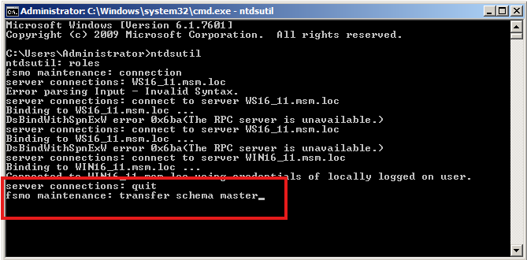
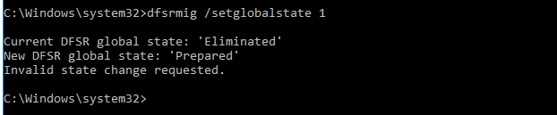
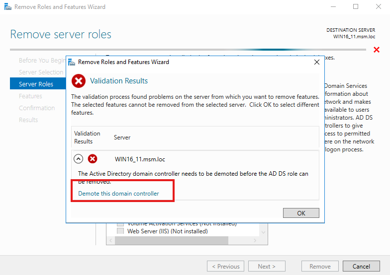
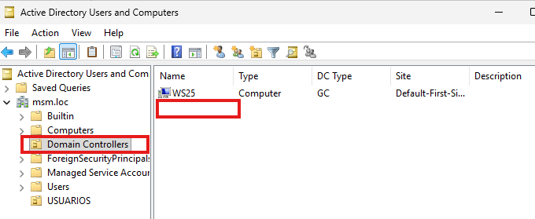

# 6. Problemas encontrados y soluciones

## 1. `ntdsutil`: "Invalid Syntax" / "RPC server is unavailable"

- **Síntoma:** al conectar con el servidor destino para transferir el Schema Master:
  ```text
  server connections: WS16_11.risso.loc
  Error parsing Input - Invalid Syntax.
  server connections: connect to server WS16_11.risso.loc
  DsBindWithSpnExW error 0x6ba (The RPC server is unavailable.)
  ```
  
- **Causas:**
  1. Se escribió solo el nombre del servidor en lugar del comando completo `connect to server <FQDN>`.
  2. El nombre estaba mal escrito (`WS16_11` en vez de `WIN16_11`), por lo que no se resolvía y el RPC no respondía.
- **Solución:** usar la sintaxis exacta `connect to server WIN16_11.risso.loc`. Con el nombre correcto, *"Connected to WIN16_11.risso.loc using credentials of locally logged on user"*.
- **Prevención:** comprobar antes con `nslookup <FQDN>` y `ping`, y evitar nombres con guiones bajos.

## 2. `dfsrmig /setglobalstate 1`: "Invalid state change requested"

- **Síntoma:** al intentar iniciar la migración de FRS a DFSR.

  
- **Causa:** el estado global ya era `Eliminated` (migración finalizada), así que no se puede volver al estado *Prepared*.
- **Solución:** no hacía falta migrar. Verificar con `dfsrmig /getglobalstate` y comprobar que los servicios DFSR están activos.
- **Prevención:** consultar siempre el estado actual antes de ejecutar `/setglobalstate`.

## 3. No se puede quitar el rol AD DS de un DC

- **Síntoma:** *Remove Roles and Features* falla con *"The Active Directory domain controller needs to be demoted before the AD DS role can be removed"*.

  
- **Causa:** un DC no puede desinstalar el rol sin ser degradado antes.
- **Solución:** degradarlo con el enlace *Demote this domain controller* o con `Uninstall-ADDSDomainController`; después ya se pueden quitar el rol y el DNS.

## 4. El DC degradado sigue apareciendo en el dominio

- **Síntoma:** tras degradar y sacar del dominio al servidor 2016, sigue figurando en *Domain Controllers* del nuevo.

  
- **Causa:** queda un objeto de equipo/metadatos residuales (a veces por replicación pendiente).
- **Solución:** esperar a la replicación y, si persiste, eliminarlo a mano desde *Active Directory Users and Computers* y limpiar metadatos (`ntdsutil` → *metadata cleanup*) y registros DNS obsoletos.

## 5. La promoción pide credenciales

- **Síntoma:** el asistente de promoción no deja continuar al añadir un DC a un dominio existente.
- **Solución:** pulsar *Change…* y escribir un usuario del dominio con permisos (p. ej. `RISSO\Administrator`); para el esquema, debe pertenecer también a *Schema Admins* / *Enterprise Admins*.

## Lecciones aprendidas

- Comprobar el estado de AD (`dcdiag`, `repadmin`, `dfsrmig /getglobalstate`) **antes y después** de cada paso.
- Mantener el servidor antiguo apagado pero disponible un tiempo como plan de vuelta atrás.
- `Move-ADDirectoryServerOperationMasterRole` ahorra mucho trabajo frente a la interfaz gráfica + `ntdsutil`.
- Planificar nombres de equipo válidos (sin `_`) desde el principio.
- Migrar por un servidor intermedio (2016) permitió hacer el salto de 2008 R2 a 2025 en pasos pequeños y reversibles.
